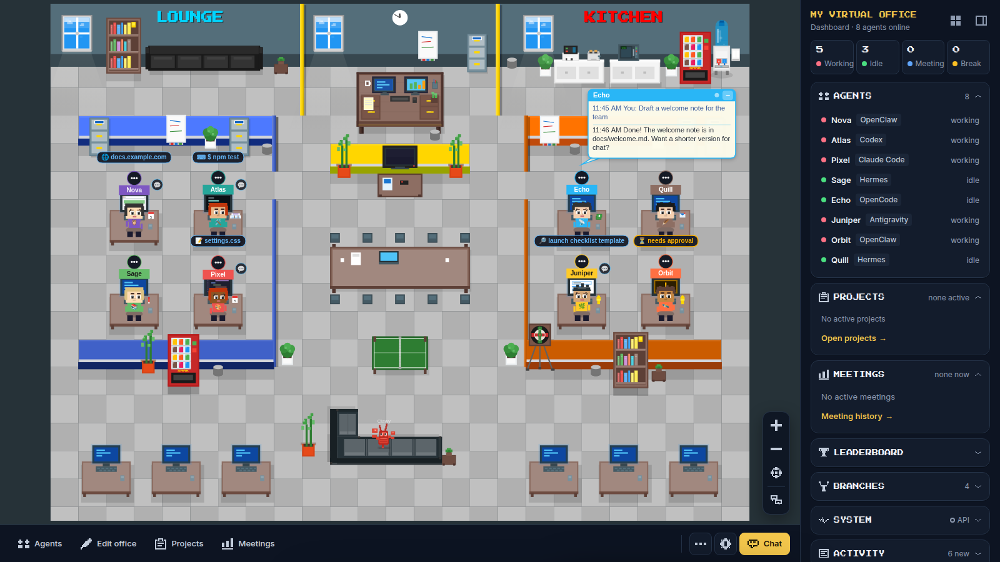

# AI Office for Android

**Real AI employees. Real conversations. Real tasks. Running on your own phone.**

A mobile-first fork/setup of [My Virtual Office v0.12.0](https://github.com/eliautobot/my-virtual-office) that runs natively in Termux — no Docker, no root, no cloud. It connects to a real **OpenCode** server on the device, so every reply, tool call and delegated subagent is produced by an actual model, not by a script.

> This repository contains modifications to upstream software that is commercially licensed. See [NOTICE.md](NOTICE.md). No license keys or license bypasses are included.

---

## Highlights

- **Five-tab portrait UI** — Office, Chat, Tasks, Agents, Settings — with touch-first controls, safe-area support, dark futuristic theme and lightweight animation.
- **Six real role agents** — CEO/Manager, Programmer, Researcher, Designer, Writer, Analyst — each defined as a real OpenCode agent with its own prompt and permissions.
- **Native delegation** — the CEO is allowed to launch the other five as OpenCode subagents and returns their real outputs.
- **Real collaboration pipeline** — create projects and tasks, run the work → review → Done workflow, inspect agent comments and results.
- **Private chat + history** — messages and replies are persisted on-device and reloaded after a restart.
- **Real error handling** — provider connection checks, unknown-agent errors, retries, and working stop/cancel through the provider interrupt API.
- **Approval checkpoint** — workflow runs require an explicit *Approve & run* confirmation in the mobile UI.
- **APK supplied** — a native WebView client that detects the local server, opens the office directly when it is running, and shows a guided setup screen otherwise.



---

## Install the APK

1. Download `ai-office-android.apk` from the **[Latest build release](../../releases/tag/latest)**.
2. Allow “Install unknown apps” for your browser/file manager and install it.
3. Open **AI Office**. If the server is not running you will see a setup screen with copyable commands.
4. Install [Termux from F-Droid](https://f-droid.org/packages/com.termux/), then run the commands shown in the app.
5. Return to the app and tap **Re-check server**. It will open `http://127.0.0.1:8090/mobile` automatically.

The APK is a thin native client; the actual AI engine runs in Termux using the real OpenCode CLI/server already on your device. Nothing is uploaded anywhere.

---

## Run from source (Termux)

```sh
pkg install python nodejs-lts -y
python3 -m pip install websockets==17.0.1

git clone https://github.com/omxrex/ai-office-android.git
cd ai-office-android
(cd app/provider-layer && npm ci --omit=dev --no-audit --no-fund)

sh scripts/start-android.sh
```

Then open `http://127.0.0.1:8090/` in any browser on the phone.

Prerequisites: the real OpenCode binary at `~/.opencode/bin/opencode`, Termux glibc packages, Python 3.11+, Node 22.19+ (24 recommended). The launcher uses Termux's glibc loader to start `opencode serve` on port 41777 and keeps its server password in a `0600` file under `VO_STATUS_DIR` (`$HOME/vo-data` by default).

See [ANDROID.md](ANDROID.md) for architecture, environment variables and test results. The full original documentation is in [UPSTREAM-README.md](UPSTREAM-README.md) and `docs/`.

---

## Why a bridge instead of calling OpenCode directly?

The upstream OpenCode binary is glibc-linked. Its long-running `opencode serve` process works under Termux's loader, but its self-spawning CLI subcommands (`opencode run`, `opencode auth`, …) fail when re-executed through that loader.

`scripts/opencode-server-bridge.py` therefore maps the office's existing OpenCode **CLI contract** to OpenCode's **documented HTTP API** (`/api/session`, `/api/session/{id}/prompt`, `/api/session/{id}/message`, `/api/session/{id}/interrupt`, …). Every model turn is executed by the real `opencode serve` process. There is no fake provider, no invented endpoint and no simulated reply.

---

## Verify it

With the server running:

```sh
python3 scripts/test-android-office.py
```

The suite checks health, mobile page/assets, real provider version, all six role agents, history persistence, error handling, project/task creation, workflow output reaching **Done**, and the mobile entry point.

---

## Repository layout

| Path | What it is |
|---|---|
| `app/` | Original My Virtual Office frontend and Python server, plus the new `mobile.html/css/js` |
| `scripts/start-android.sh` | Native Termux launcher |
| `scripts/setup_office_agents.py` | Creates the six real OpenCode agent definitions |
| `scripts/opencode-server-bridge.py` | Real OpenCode CLI-contract → HTTP-API bridge |
| `scripts/test-android-office.py` | End-to-end smoke test |
| `android-app/index.html` | APK onboarding/launcher screen source |
| `.github/workflows/build-apk.yml` | Builds the APK on GitHub Actions and attaches it to the `latest` release |
| `ANDROID.md` | Detailed Android notes and honest limitations |

---

## Limitations (read this)

- The APK needs the Termux server running locally; it is **not** a self-contained Python runtime.
- The unmodified upstream demo license limits its own agent roster to three entries. This was **not** bypassed. The six employees are native OpenCode agents and the CEO delegates to them inside OpenCode.
- OpenCode has no provider-level approval protocol, so the workflow confirmation is an office-side checkpoint.
- Visual browser automation was unavailable during development; the mobile UI was validated structurally and against live APIs, not via a rendered screenshot test.
- See [ANDROID.md](ANDROID.md) for the full list.
